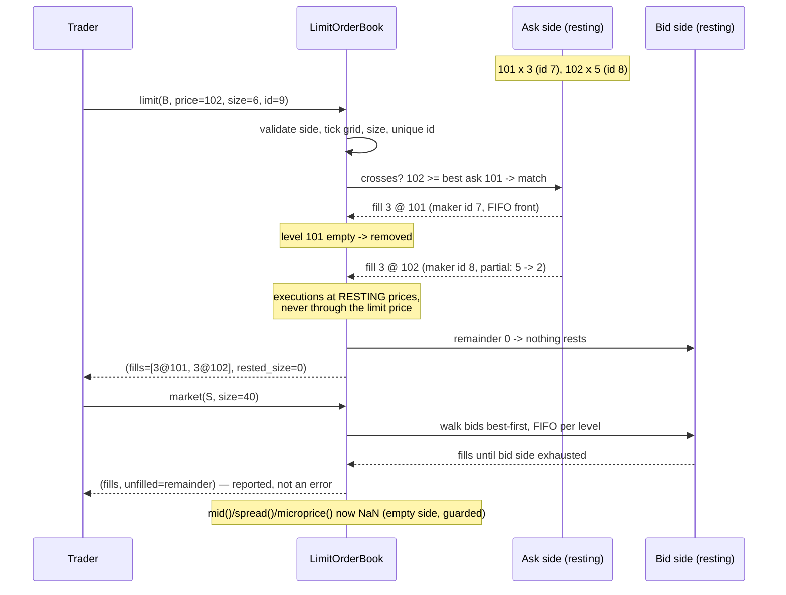

# ARCHITECTURE — `lobmod`

Design notes for the four parallel implementations (Python `lobmod`, C++
`lobmod::`, Rust crate `lobmod`, Java `com.quant.lobmod`). The single source of
truth for behavior is `API_SPEC.md`; this document explains *why* the pieces
look the way they do.

## 1. Component responsibilities

| Component | Responsibility | Depends on |
|---|---|---|
| `rng` (`Lcg64`) | The **only** source of randomness project-wide: pinned Knuth/MMIX 64-bit LCG; uniform / exponential / geometric / randint with pinned formulas and draw order | — |
| `book` (`LimitOrderBook`) | Price-time priority matching on an integer tick grid: limit adds (incl. marketable/crossed), cancels by id, market orders with partial fills; mid / spread / microprice / depth, NaN-guarded | — |
| `replay` | Event schema (`L`/`C`/`M`), CSV i/o, deterministic replay producing per-event `BookStates` arrays | `book` |
| `zi` | Zero-intelligence flow generator (Smith-Farmer style): pinned rates, geometric placement, seeded; maintains an internal book so quotes evolve exactly as a replay would | `book`, `replay`, `rng` |
| `hawkes` | Uni/bivariate exponential-kernel Hawkes: O(N) log-likelihood recursions plus O(N²) brute-force references, Ogata-thinning simulation, MLE on log-parameters, time-rescaling residuals, branching diagnostics | `neldermead`, `rng` |
| `neldermead` | Native derivative-free minimizer, pinned to the coefficient (Lagarias 1998 decision tree, stable tie-break, scipy initial-simplex rule) | — |
| `gof` | KS statistic vs Exp(1) and pinned 100-term Kolmogorov p-value with Stephens correction | — |
| `features` | OFI series (Cont-Kukanov-Stoikov), the pinned 5-feature vector, 3-class labels with an epsilon dead zone, row-validity rules, chronological split | `replay` |
| `nn` | Deterministic MLP/logistic (pinned sin init, full-batch GD, max-shifted softmax), standardizer, accuracy / confusion matrix / majority baseline / signal PnL | — |

Dependency edges only point "down" (no cycles); `book`, `neldermead`, `gof`,
`nn` and `rng` are leaves reusable in isolation.

## 2. Data flow

```mermaid
flowchart TD
    subgraph DATA["data/ (bundled, deterministic)"]
        LC[lob_events.csv<br/>5000 events, seed 20240613]
        HU[hawkes_uni.csv<br/>1211 event times, seed 101]
        HB[hawkes_biv.csv<br/>611 times+types, seed 33]
        FC[features_config.json]
        GJ[golden/golden.json<br/>18 cases]
    end

    subgraph GEN["Generation (regenerable)"]
        RNG[Lcg64<br/>pinned 64-bit LCG]
        ZI[zi.generate_events<br/>zero-intelligence flow]
        SIM[hawkes.simulate_uni/biv<br/>Ogata thinning]
        RNG --> ZI
        RNG --> SIM
    end
    ZI --> LC
    SIM --> HU
    SIM --> HB

    subgraph BOOKSIDE["Book pipeline"]
        RD[replay.read_events_csv] --> RP[replay.replay]
        BK[LimitOrderBook<br/>price-time priority] --- RP
        RP --> BS[BookStates<br/>per-event top-of-book arrays]
        BS --> FE[features.compute_features<br/>OFI, QI, spread, depth ratio, ret<br/>labels: down/flat/up]
        FE --> SP[chronological_split 70/30]
        SP --> STD[Standardizer<br/>train moments only]
        STD --> NN[MLP 5-16-8-3<br/>full-batch GD, pinned init]
        STD --> LG[logistic baseline<br/>MLP with no hidden layers]
        SP --> MJ[majority baseline]
        NN --> MET[accuracy, confusion matrix]
        LG --> MET
        MJ --> MET
        NN --> PNL[signal_pnl<br/>gross vs net after half-spread]
    end
    LC --> RD
    FC --> FE

    subgraph HAWKESIDE["Hawkes pipeline"]
        LL[uni_loglik / biv_loglik<br/>O(N) recursion + brute-force check]
        NM[nelder_mead<br/>on log-parameters]
        FIT[fit_uni / fit_biv<br/>branching, spectral radius, warnings]
        RES[uni_residuals / biv_residuals<br/>time-rescaling]
        KS[gof.ks_test_exp<br/>D + Stephens p-value]
        LL --> NM --> FIT --> RES --> KS
    end
    HU --> LL
    HB --> LL

    MET --> GOLD[golden tests<br/>all four languages]
    PNL --> GOLD
    KS --> GOLD
    BS --> GOLD
    GJ --> GOLD
```

Two independent pipelines share nothing but the RNG and the golden harness:
the **book pipeline** is pure integer bookkeeping until features turn states
into doubles; the **Hawkes pipeline** is pure floating-point on event times.
This separation is what lets each language port and test them independently.

## 3. Component relationships

```mermaid
classDiagram
    class Lcg64 {
        -state: u64
        +next_u64() u64
        +uniform() f64
        +exponential(rate) f64
        +geometric(p) int
        +randint(n) int
    }
    class LimitOrderBook {
        -bids: map~ticks, FIFO~
        -asks: map~ticks, FIFO~
        -orders: map~id, side x ticks~
        +limit(side, price, size, id) fills, rested
        +cancel(id) removed_size
        +market(side, size) fills, unfilled
        +mid() f64
        +microprice() f64
        +spread() f64
        +depth(side, k) int
    }
    class Event {
        +seq: int
        +etype: L C M
        +side: B S
        +price size order_id
    }
    class BookStates {
        +best_bid best_ask
        +bid_size ask_size
        +bid_depth_k ask_depth_k
        +mid microprice spread
    }
    class FeatureSet {
        +X: n x 5
        +y: labels 0 1 2
        +fwd_ret spread
    }
    class HawkesUniFit {
        +mu alpha beta
        +loglik branching
        +converged n_iter
    }
    class HawkesBivFit {
        +mu[2] alpha[2][2] beta
        +branching spectral_radius
    }
    class NMResult {
        +x fval n_iter converged
    }
    class MLP {
        -weights biases (pinned sin init)
        +fit(X, y, lr, epochs) history
        +predict(X) labels
        +loss_and_grads(X, y)
    }
    class Standardizer {
        +fit(X_train)
        +transform(X)
    }

    Lcg64 <.. "zi.generate_events" : draws
    Lcg64 <.. "hawkes.simulate" : draws
    "zi.generate_events" ..> LimitOrderBook : maintains
    "zi.generate_events" ..> Event : emits
    "replay.replay" ..> LimitOrderBook : applies events
    "replay.replay" ..> BookStates : records
    BookStates <.. "features.compute_features" : reads
    "features.compute_features" ..> FeatureSet : builds
    FeatureSet <.. Standardizer
    FeatureSet <.. MLP
    "hawkes.fit_uni" ..> NMResult : uses nelder_mead
    "hawkes.fit_uni" ..> HawkesUniFit : returns
    "hawkes.fit_biv" ..> HawkesBivFit : returns
    HawkesUniFit <.. "gof.ks_test_exp" : residuals tested
```

## 4. Matching-engine walkthrough



Raw sources for all three diagrams live in `docs/diagrams/*.mmd`.

## 5. Numerical design decisions and trade-offs

- **Integer ticks inside the book.** Prices are stored as integer tick counts;
  matching, depth and size conservation are exact integer arithmetic. Doubles
  appear only in derived quantities (mid, microprice) and at the API boundary,
  where grid membership is validated with a 1e-9 *relative* tolerance
  (`|p/tick − round(p/tick)| ≤ 1e-9·max(1, |p/tick|)`) so that e.g.
  `100.0000000001` with tick `0.01` is accepted but `100.004` is not.
  Trade-off: submitting prices as doubles is ergonomic; the tolerance rule is
  the cost of that ergonomics.
- **One pinned LCG, no built-in RNGs.** Language-native RNGs differ across
  platforms and versions; the Knuth/MMIX LCG is four lines everywhere, and the
  spec pins the *number and order* of uniform draws in every algorithm (two
  per thinning iteration; `u1, u2[, u3]` in the ZI generator). Trade-off: an
  LCG is statistically weaker than PCG/Mersenne — irrelevant here, decisive
  for cross-language golden tests.
- **O(N) likelihood recursions with brute-force twins.** Every recursion
  (`R_i`, the bivariate decayed sums `S_0, S_1`) ships next to a direct O(N²)
  evaluator; tests demand 1e-10 agreement. The fast path is the product; the
  slow path is executable documentation and a tripwire for off-by-one decay
  errors.
- **`expm1`/`log1p` at the edges.** Compensator tails use
  `expm1(−β(T−t_i))`; the Exp(1) CDF is `−expm1(−x)`; exponential draws use
  `−log1p(−u)`. Each avoids catastrophic cancellation or `log(0)` at exactly
  the parameter ranges the optimizer explores.
- **Log-transformed MLE with a penalty objective.** Nelder-Mead runs on
  `log`-parameters (positivity by construction, better conditioning) and the
  objective returns `1e10` on any overflow/non-finite evaluation instead of
  throwing — the optimizer's contract is a total function. The bivariate fit
  chains two NM runs (pinned) because a 7-dimensional simplex can stall; a
  deterministic restart is cheaper than a smarter optimizer and stays
  bit-reproducible.
- **Diagnostics warn, validation throws.** Bad *inputs* (negative sizes,
  unknown cancel ids, non-increasing times) fail fast. Bad *model outcomes*
  (branching ≥ 0.9 or ≥ 1, NM hitting maxiter) are reported on the result
  object with a warning — a fit you can inspect beats an exception that
  destroys it.
- **Determinism as a design axis in the NN.** sin-based init, full-batch GD,
  no shuffling, pinned tie-breaks (argmax → lowest index; NM sort stable by
  `(f, index)`), population-variance standardization with an explicit
  `std < 1e-12 → 1` floor. Sacrifices training efficiency for 1e-8
  cross-language reproducibility of a *trained* model — the correct trade for
  a reference implementation.
- **Softmax max-shift and log floor.** Row-max subtraction bounds every
  exponent by 0; the picked probability is floored at 1e-300 before `log`.
  Together they make loss and gradients finite for arbitrarily bad logits.

## 6. Error-handling strategy per language

Uniform rule: *invalid input → immediate, typed, message-carrying error;
recoverable model diagnostics → reported, never thrown.*

| Language | Invalid input | Notes |
|---|---|---|
| Python | `raise ValueError("...")` | warnings via `warnings.warn(RuntimeWarning)` for near-critical/non-stationary fits |
| C++ | `throw std::invalid_argument` (`std::domain_error` for numeric-domain violations) | warnings surface as flags/fields on result structs |
| Rust | `Result<_, LobError>` — a manual thiserror-style enum; **no panics on bad input** | `?`-friendly API; diagnostics are fields on fit results |
| Java | `throw IllegalArgumentException` | result objects carry `converged`, branching etc. |

Shared conventions: NaN is a *value*, not an error, for empty-side book
quantities (mid/spread/microprice) — callers of the feature pipeline rely on
NaN propagation to drop invalid rows. A market order exceeding total depth
*reports* the unfilled remainder. Objectives passed to Nelder-Mead must never
raise; out-of-domain points return the `1e10` penalty.

## 7. Testing strategy

1. **Golden values (cross-language contract).** `data/golden/golden.json` — 18
   cases spanning every component (book snapshots, microprice, OFI, both
   Hawkes likelihoods, fits, KS, NN losses/accuracies, PnL). Each language
   parses the flat JSON (C++/Java: minimal hand-rolled reader is acceptable;
   Rust: serde_json) and asserts `|computed − expected| ≤ tol`. Tolerances are
   graduated deliberately: 1e-12 where arithmetic is exact (book), 1e-8 for
   pinned deterministic float pipelines (likelihood values, NN losses), 1e-4/
   1e-3 for optimizer outputs where libm differences accumulate across
   thousands of objective evaluations.
2. **Property-style invariants.** Replay the full 5000-event stream asserting
   after every event: `best_bid < best_ask` whenever both exist; size
   conservation per limit order (added = rested + cancelled + maker fills +
   marketable-taker fills); FIFO and price priority via targeted sequences;
   depth monotone in `k`. KS p-value in [0, 1] and monotone in D over a grid.
   Softmax rows sum to 1.
3. **Independent-recomputation checks.** Recursion vs brute force (1e-10, uni
   and biv); backprop vs central finite differences (rel. 1e-6); residual
   means near 1 with monotone compensators; simulated-then-refitted parameters
   close to the DGP (loose tolerances — MLE variance is real).
4. **Statistical behavior tests.** KS at true parameters fails to reject
   (p > 0.05); deliberately wrong parameters reject; near-critical DGP
   (branching 0.95) fits *with* a warning; tiny-n KS (n = 1, 3) works.
5. **Edge/error paths.** Market order bigger than the book, cancel of unknown
   id, crossed limits, empty-side NaN guards, tick validation, degenerate
   one-class labels (train runs; majority wins), every validation error
   surfacing per the table in §6.
6. **Determinism tests.** Same seed ⇒ identical simulated streams; retraining
   the NN reproduces goldens bit-for-tolerance.

## 8. Performance notes

- Complexity budget: replay is O(E · L) with L the touched levels (in practice
  ~O(E)); depth-k queries sort live levels — fine for books with tens of
  levels, would become a heap/sorted-map in a production engine. Hawkes
  likelihood and residuals are O(N); simulation is O(accepted + rejected)
  candidates, with rejection rate governed by how fast intensity decays
  between events. NN training is O(epochs · n · Σ layer sizes) dense GEMMs —
  the 800-epoch pipeline is a few seconds in Python/NumPy and well under a
  second in the native languages.
- The pinned full-pipeline goldens (replay → features → 800-epoch training)
  are the slowest tests; each language keeps total test runtime under the
  ~60 s budget on 2 CPUs, computing the shared pipeline once per test binary
  (fixture/lazy-static/singleton) rather than per golden case.
- Nelder-Mead on the 7-parameter bivariate likelihood dominates fit time
  (thousands of O(N) objective evaluations); the two-stage restart doubles
  that deliberately in exchange for basin-escape robustness. If speed ever
  mattered, the exponential-kernel likelihood has analytic gradients — the
  from-scratch, derivative-free choice is pedagogical and pinned.
- Memory: everything is column arrays of length E or N; the 5000-event replay
  state is ~9 × 5000 doubles. No allocation is required on the matching hot
  path beyond level creation/removal.
