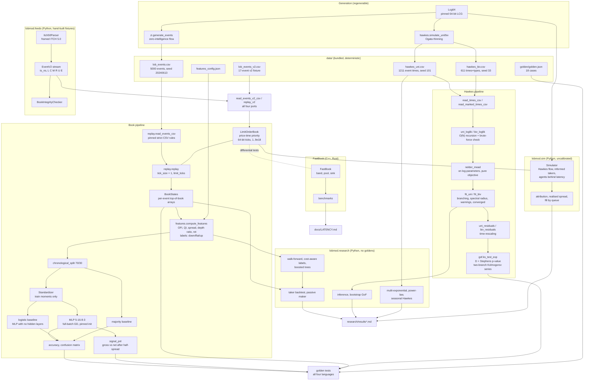
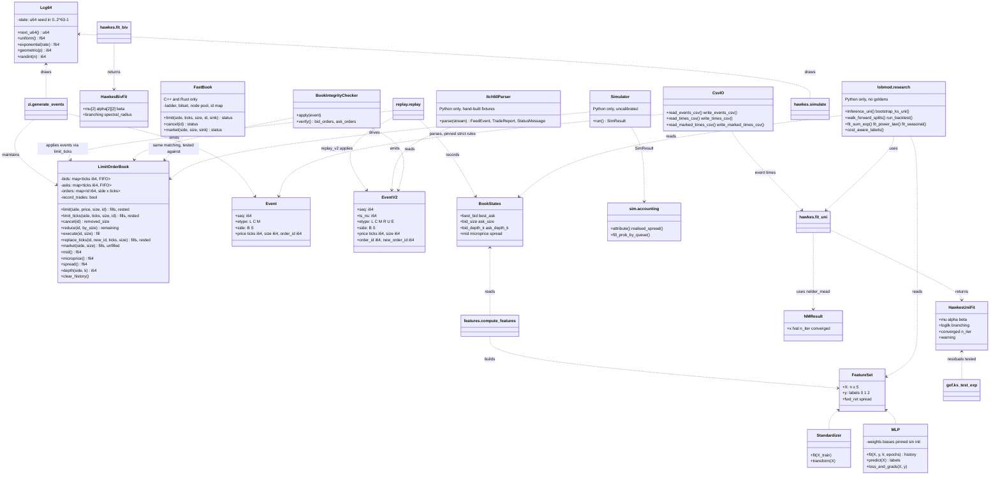

# ARCHITECTURE — `lobmod`

Design notes for the four parallel implementations (Python `lobmod`, C++
`lobmod::`, Rust crate `lobmod`, Java `com.quant.lobmod`). The single source of
truth for behavior is `API_SPEC.md`; this document explains *why* the pieces
look the way they do.

## 1. Component responsibilities

| Component | Responsibility | Depends on |
|---|---|---|
| `rng` (`Lcg64`) | The **only** source of randomness project-wide: pinned Knuth/MMIX 64-bit LCG; uniform / exponential / geometric / randint with pinned formulas and draw order | — |
| `book` (`LimitOrderBook`) | Price-time priority matching on an integer tick grid: limit adds (incl. marketable/crossed), cancels by id, market orders with partial fills, `reduce` (keeps queue place), `execute` (fills a named order at its price), `replace` (new id at the tail, priority lost; a crossing replace executes); mid / spread / microprice / depth, NaN-guarded | — |
| `replay` | Event schemas (v1 `L`/`C`/`M`; v2 adds `ts_ns` and `R`/`U`/`E`, and its reader lifts v1 files), event CSV i/o under the pinned strict parsing rules, deterministic replay (`tick_size = 1`, prices are tick counts) producing per-event `BookStates` arrays | `book`, `csv` |
| `csv` (C++/Rust/Java module; Python helpers in `replay`) | Shared pinned CSV primitives: header check, CRLF strip, trailing-blank-line rule, strict `-?[0-9]+` / finite-float field grammar | — |
| `zi` | Zero-intelligence flow generator (inspired by Smith et al. 2003, not the same model): pinned rates, geometric placement, seeded; maintains an internal book so quotes evolve exactly as a replay would | `book`, `replay`, `rng` |
| `hawkes` | Uni/bivariate exponential-kernel Hawkes: O(N) log-likelihood recursions plus O(N²) brute-force references, Ogata-thinning simulation (bounded by `MAX_CANDIDATES`), MLE on log-parameters with exposed pure objectives and a `maxiter` cap, time-rescaling residuals, branching diagnostics, `t` / `t,type` CSV i/o | `neldermead`, `rng`, `csv` |
| `neldermead` | Native derivative-free minimizer, pinned to the coefficient (Lagarias 1998 decision tree, stable tie-break, scipy initial-simplex rule) | — |
| `gof` | KS statistic vs Exp(1) and the pinned two-branch (100-term alternating / 100-term dual) Kolmogorov p-value with Stephens correction | — |
| `features` | OFI series (Cont-Kukanov-Stoikov), the pinned 5-feature vector, 3-class labels with an epsilon dead zone, row-validity rules, chronological split | `replay` |
| `nn` | Deterministic MLP/logistic (pinned sin init, full-batch GD, max-shifted softmax), standardizer, accuracy / confusion matrix / majority baseline / signal PnL | — |

Dependency edges only point "down" (no cycles); `book`, `neldermead`, `gof`,
`nn` and `rng` are leaves reusable in isolation.

## 2. Data flow

Two independent pipelines share nothing but the RNG and the golden harness:
the **book pipeline** is pure integer bookkeeping until features turn states
into doubles; the **Hawkes pipeline** is pure floating-point on event times.
This separation is what lets each language port and test them independently.

## 3. Component relationships

## 4. Matching-engine walkthrough

Raw sources for all three diagrams live in `docs/diagrams/*.mmd`.

## 5. Numerical design decisions and trade-offs

- **Integer ticks inside the book — 64-bit everywhere.** Prices are stored as
  signed 64-bit tick counts in all four ports (Java included: an earlier
  `int` narrowing turned a 3·10⁹-tick limit into a negative price that the
  matcher read as "no bound", i.e. an unbounded sweep — the price bound is
  now an explicit flag, never a sentinel value); matching, depth and size
  conservation are exact integer arithmetic. Doubles appear only in derived
  quantities (mid, microprice) and at the API boundary, where the pinned
  conversion rounds half up, validates grid membership with a 1e-9
  *relative* tolerance (`|p/tick − round(p/tick)| ≤ 1e-9·max(1, |p/tick|)`, so
  `100.0000000001` with tick `0.01` is accepted but `100.004` is not) and then
  requires `1 ≤ ticks ≤ 9·10¹⁸` — a price that rounds to 0 ticks or overflows
  is an error, never a tick-0 order or undefined behaviour. `limit_ticks`
  bypasses the float path for callers (replay) that already hold tick counts.
  Trade-off: submitting prices as doubles is ergonomic; the tolerance rule is
  the cost of that ergonomics.
- **One pinned LCG, no built-in RNGs.** Language-native RNGs differ across
  platforms and versions; the Knuth/MMIX LCG is four lines everywhere, and the
  spec pins the *number and order* of uniform draws in every algorithm (two
  per thinning iteration; `u1, u2[, u3]` in the ZI generator). Seeds are
  pinned to `[0, 2⁶³−1]` — the range every port can hold without wrapping —
  and are never masked. Trade-off: an LCG is statistically weaker than
  PCG/Mersenne — irrelevant here, decisive for cross-language golden tests.
- **O(N) likelihood recursions with brute-force twins.** Every recursion
  (`R_i`, the bivariate decayed sums `S_0, S_1`) ships next to a direct O(N²)
  evaluator; tests demand 1e-10 agreement. The fast path is the product; the
  slow path is executable documentation and a tripwire for off-by-one decay
  errors.
- **`expm1`/`log1p` at the edges.** Compensator tails use
  `expm1(−β(T−t_i))`; the Exp(1) CDF is `−expm1(−x)`; exponential draws use
  `−log1p(−u)`. Each avoids catastrophic cancellation or `log(0)` at exactly
  the parameter ranges the optimizer explores.
- **Log-transformed MLE with a penalty objective.** Nelder-Mead runs on
  `log`-parameters (positivity by construction, better conditioning) and the
  objective returns `1e10` on any overflow/non-finite evaluation *and* on
  `exp` underflow of a strictly-positive parameter to exactly 0 (a vertex at
  `log mu < −745` is reachable on strongly clustered data) instead of
  throwing — the optimizer's contract is a total function, and the objectives
  are exposed (`uni_fit_objective`, `biv_fit_objective`) so tests can prove
  it. The bivariate fit chains two NM runs (pinned) because a 7-dimensional
  simplex can stall; a deterministic restart is cheaper than a smarter
  optimizer and stays bit-reproducible. `converged` is the tolerance flag and
  nothing else: a fit stopped by `maxiter` reports `false`.
- **Diagnostics warn, validation throws.** Bad *inputs* (negative sizes,
  unknown cancel ids, non-increasing times) fail fast. Bad *model outcomes*
  (branching ≥ 0.9 or ≥ 1, NM hitting maxiter) are reported on the result
  object with a warning — a fit you can inspect beats an exception that
  destroys it.
- **Determinism as a design axis in the NN.** sin-based init, full-batch GD,
  no shuffling, pinned tie-breaks (argmax → lowest index; NM sort stable by
  `(f, index)`), population-variance standardization with an explicit
  `std < 1e-12 → 1` floor. Sacrifices training efficiency for 1e-8
  cross-language reproducibility of a *trained* model — the correct trade for
  a reference implementation.
- **Softmax max-shift and log floor.** Row-max subtraction bounds every
  exponent by 0; the picked probability is floored at 1e-300 before `log`.
  Together they make loss and gradients finite for arbitrarily bad logits.
- **Two Kolmogorov series.** The alternating tail series `2Σ(−1)^{j−1}e^{−2j²λ²}`
  converges slowly as λ → 0 (100 terms are off by 0.13 at λ = 0.01 — reachable
  with `D ≈ 1/(2n)` on large synthetic samples); below the pinned switch
  λ < 0.1 the dual Jacobi-theta form is used, whose terms underflow to 0 and
  give `p = 1` exactly. Both forms agree to machine precision at the switch,
  and the golden case (λ ≈ 0.6) is untouched.
- **Bounded loops.** Ogata thinning terminates almost surely but has no finite
  worst case; every simulator caps candidate draws at 5·10⁷ and errors beyond
  it. Nelder-Mead is capped by `maxiter`, matching by the number of levels,
  the ZI generator by `n_events`.
- **Strict CSV.** The three bundled schemas share one pinned grammar (exact
  header, CRLF tolerated, only *trailing* blank lines, `-?[0-9]+` integers in
  64-bit range, finite floats, `type`/`side` validated at parse time). A
  truncated or hand-edited file fails loudly in every language rather than
  being silently skipped over by one port and rejected by another.

## 6. Error-handling strategy per language

Uniform rule: *invalid input → immediate, typed, message-carrying error;
recoverable model diagnostics → reported, never thrown.*

| Language | Invalid input | Notes |
|---|---|---|
| Python | `raise ValueError("...")` | warnings via `warnings.warn(RuntimeWarning)` for near-critical/non-stationary fits |
| C++ | `throw std::invalid_argument` (`std::domain_error` for numeric-domain violations) | warnings surface as flags/fields on result structs |
| Rust | `Result<_, LobError>` — a manual thiserror-style enum; **no panics on bad input** (including `Matrix::from_vec` / `slice_rows`, which return `Result`) | `?`-friendly API; diagnostics are fields on fit results |
| Java | `throw IllegalArgumentException` | result objects carry `converged`, branching etc. |

Shared conventions: NaN is a *value*, not an error, for empty-side book
quantities (mid/spread/microprice) — callers of the feature pipeline rely on
NaN propagation to drop invalid rows; `ofi_at(i, w)` is the one place where a
NaN would be a *bug*, so it errors iff `i < w` in every port (`e_0` is
undefined). A market order exceeding total depth *reports* the unfilled
remainder. Objectives passed to Nelder-Mead must never raise; out-of-domain
points return the `1e10` penalty. Python accepts any `numbers.Integral`
(numpy scalars included) where an integer is required, never a `bool`, and
never truncates a non-integral float. C++ throws `std::invalid_argument` even
for out-of-range CSV integers (never `std::out_of_range`).

## 7. Testing strategy

1. **Golden values (cross-language contract).** `data/golden/golden.json` — 18
   cases spanning every component (book snapshots, microprice, OFI, both
   Hawkes likelihoods, fits, KS, NN losses/accuracies, PnL). Each language
   parses the flat JSON (C++/Java: minimal hand-rolled reader is acceptable;
   Rust: serde_json) and asserts `|computed − expected| ≤ tol`. Tolerances are
   graduated deliberately: 1e-12 where arithmetic is exact (book), 1e-8 for
   pinned deterministic float pipelines (likelihood values, NN losses), 1e-4/
   1e-3 for optimizer outputs where libm differences accumulate across
   thousands of objective evaluations. The accuracy/PnL goldens are
   argmax-discrete (one flipped prediction = 7.7e-4); they hold bit-for-bit
   here but a 1-ulp libm difference elsewhere could flip a near-tie (README).
2. **Property-style invariants.** Replay the full 5000-event stream asserting
   after every event: `best_bid < best_ask` whenever both exist; size
   conservation per limit order (added = rested + cancelled + maker fills +
   marketable-taker fills); FIFO and price priority via targeted sequences;
   `depth(side, k) ≤ depth(side, k+1)` and `depth(side, 1) = best size` over
   the first 500 events. KS p-value in [0, 1] and monotone in D over a grid,
   including across the two-series switch. Softmax rows sum to 1.
3. **Independent-recomputation checks.** Recursion vs brute force (1e-10, uni
   and biv); backprop vs central finite differences (rel. 1e-6); residual
   means near 1 with monotone compensators; simulated-then-refitted parameters
   close to the DGP (loose tolerances — MLE variance is real).
4. **Statistical behavior tests.** KS at true parameters fails to reject
   (p > 0.05); deliberately wrong parameters reject; near-critical DGP
   (branching 0.95) fits *with* a warning; tiny-n KS (n = 1, 3) works.
5. **Edge/error paths.** Market order bigger than the book and on an empty
   book, cancel of unknown id and reuse of a cancelled id, crossed limits
   (stop at own price, price improvement), empty-side NaN guards, tick
   validation including prices that round to 0 ticks and 6·10¹² / 10³⁰⁰-tick
   prices, CSV robustness (CRLF, trailing/interior blank lines, trailing
   comma, non-integer field, reordered header, 2⁶³), pure objectives under
   `exp` underflow, `fit_*` with `maxiter = 1` reporting `converged = false`,
   Poisson (α = 0) and single-event (N = 1, t_N = T) limits, small-λ KS
   accuracy, `signal_pnl` label validation, `ofi_at` at the window boundary,
   logistic-head and two-class gradient checks, degenerate one-class labels
   (train runs; majority wins), every validation error surfacing per the
   table in §6.
6. **Determinism tests.** Same seed ⇒ identical simulated streams; every
   bundled CSV regenerates byte-for-byte from its seed through the library's
   own writer (Python and C++ writers are byte-identical to the bundled
   files; Rust/Java writers round-trip exactly); retraining the NN reproduces
   goldens bit-for-tolerance.

Current test counts: see CI.

## 8. Performance notes

- Complexity budget: replay is O(E · L) with L the touched levels (in practice
  ~O(E)); depth-k queries walk the ordered level map (Python sorts live
  levels) — fine for books with tens of levels. Hawkes likelihood and
  residuals are O(N); simulation is O(accepted + rejected) candidates, with
  rejection rate governed by how fast intensity decays between events. NN
  training is O(epochs · n · Σ layer sizes) dense GEMMs.
- Measured on this 2-vCPU Linux container (Python 3.11 / numpy 2.4, g++ 13
  -O3, rustc 1.95 release, OpenJDK 21), whole test suites including the
  800-epoch pipeline: Python ≈ 4.5 s, C++ ≈ 2.5 s, Rust ≈ 6 s, Java ≈ 5 s.
  Each language computes the shared pipeline once per test binary
  (fixture / `OnceLock` / static singleton) rather than per golden case.
  These are measurements, not guarantees; nothing in the code enforces a
  time budget.
- Nelder-Mead on the 7-parameter bivariate likelihood dominates fit time
  (thousands of O(N) objective evaluations); the two-stage restart doubles
  that deliberately in exchange for basin-escape robustness. If speed ever
  mattered, the exponential-kernel likelihood has analytic gradients — the
  from-scratch, derivative-free choice is pedagogical and pinned.
- Memory: everything is column arrays of length E or N; the 5000-event replay
  state is ~9 × 5000 doubles. No allocation is required on the matching hot
  path beyond level creation/removal. A book's `trades` (and Python/C++
  `log`) grow by one entry per fill/event for its lifetime — a full trading
  day of tens of millions of events keeps every fill in memory unless the
  book is built with `record_trades = false` or `clear_history()` is called;
  replay and the ZI generator use non-recording books. Java's `trades()` is
  an O(1) unmodifiable view, not a copy.

## Layers added after v1.2.0

The pinned core stays the reference, and v1 files and goldens did not change.
`reduce`, `execute`, `replace` and schema v2 are in all four ports and specified
in `API_SPEC.md`. Everything else below is outside the golden contract.

| Layer | Languages | Input | Output |
|---|---|---|---|
| `lobmod.feeds` | Python | framed ITCH 5.0 bytes | `EventV2` per symbol, trade and status records; `BookIntegrityChecker` flags impossible book states |
| `lobmod.research` | Python | `BookStates`, `FeatureSet`, event times | standard errors, tests, folds, backtests, kernel and seasonal fits; tables in `research/results*.md` |
| `lobmod.sim` | Python | assumed `FlowParams`, `AgentSpec` list, seed | `SimResult`, then attribution; tables in `research/results_sim.md` |
| `FastBook` | C++, Rust | integer-tick orders and a fill callback | status codes; timings in `LATENCY.md` |

Data flows one way. A feed produces v2 events, and those replay through the same
`LimitOrderBook` as the bundled files. Because the book matches any add at or
through the opposite best while a feed reports executions separately,
`BookIntegrityChecker` holds crossing adds out of the book instead of inventing
trades. Research reads book states and never writes back into the core. The
simulator drives a real `LimitOrderBook` from a clock-time event heap and books
cash separately from the attribution, so their agreement is a real check.

`FastBook` is a separate implementation for speed. It is not pinned by goldens;
randomized differential tests hold it to the reference book, and prices outside
its configured band return an error code. It has `limit`, `cancel` and `market`
only, so it cannot replay v2 `R`, `U` or `E` events. `research/` scripts and
`fuzz/` harnesses are tools around the code and nothing depends on them.
